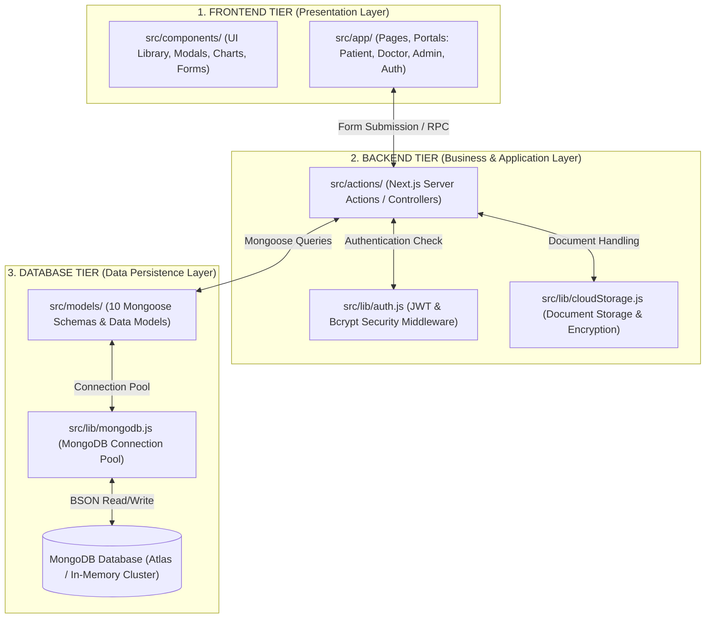

# VALORA – 3-Tier System Architecture & Project Organization

This document provides a comprehensive guide to the **3-Tier Architecture** of the **VALORA Healthcare Platform**, mapping the Next.js unified full-stack codebase into **Frontend**, **Backend**, and **Database** layers for presentations, project evaluations, and viva defense.

---

## 1. High-Level 3-Tier Architecture Overview

Modern full-stack frameworks like **Next.js (App Router)** use a unified architecture where Frontend and Backend run in a single high-performance runtime. The project is strictly divided into three distinct architectural tiers:

---

## 2. Directory Mapping Table (Frontend vs Backend vs Database)

| Tier | Directory Path | Responsibility / Technology | Key Files |
| :--- | :--- | :--- | :--- |
| **Frontend** | `src/app/` | **Client Views & Routing** Next.js App Router, React 19, Tailwind CSS | `patient/`, `doctor/`, `admin/`, `login/`, `register/`, `page.js` |
| **Frontend** | `src/components/` | **Reusable UI Components** Component library, Charts, Modals, Sidebar | `components/ui/`, `components/forms/`, `components/charts/`, `components/common/` |
| **Backend** | `src/actions/` | **Server Actions (Controllers)** Next.js `'use server'`, Business Logic, Authorization | `authActions.js`, `doctorActions.js`, `patientActions.js`, `medicalRecordActions.js`, `appointmentActions.js` |
| **Backend** | `src/lib/` | **Middleware & Security Services** Bcrypt hashing, JWT Cookies, File Encryption | `auth.js`, `cloudStorage.js`, `validations.js`, `seed.js` |
| **Database** | `src/models/` | **Data Models (Schemas)** Mongoose ODM Schemas, Data Validation & Types | `User.js`, `Patient.js`, `Doctor.js`, `MedicalRecord.js`, `Appointment.js`, `Consultation.js`, `Prescription.js`, `Review.js` |
| **Database** | `src/lib/mongodb.js` | **Database Driver & Connection Pool** MongoDB Atlas connection pooling & fallback | `mongodb.js` (Zero-config connection cache) |

---

## 3. Tier 1: Frontend (Presentation Layer)

The frontend is responsible for everything the user interacts with across the 3 portals (Patient, Doctor, Admin).

### Key Directories:
1. **`src/app/` (Pages & Routes)**:
   - `/` : Landing Page showcasing features, security certifications, and services.
   - `/login` & `/register` : Multi-role authentication views with role-based redirection.
   - `/patient/*` : Patient portal (Dashboard, Medical Records Vault, Find Doctors, Appointments, History).
   - `/doctor/*` : Doctor workbench (Dashboard, My Patients Roster, Patient Reviews, Profile).
   - `/admin/*` : Administrative governance (Analytics, Doctor verification, System logs).
2. **`src/components/` (UI Library)**:
   - `components/ui/` : Atomic UI building blocks (`Modal.js`, `StatCard.js`, `Badge.js`).
   - `components/forms/` : Input dialogs (`MedicalRecordUploadModal.js` with library permission flow, `AppointmentBookingModal.js`, `ConsultationNoteModal.js`).
   - `components/doctor/` : Specialized doctor widgets (`PatientMedicalProfileModal.js` displaying prior doctor consultations and reports).
   - `components/charts/` : Data visualization using Chart.js & react-chartjs-2.
   - `components/common/` : Global layouts (`Navbar.js`, `Sidebar.js`, `Footer.js`).

---

## 4. Tier 2: Backend (Application & Controller Layer)

VALORA uses Next.js **Server Actions** (`'use server'`). In modern web engineering, Server Actions replace traditional Express.js REST APIs with direct Remote Procedure Calls (RPC), eliminating boilerplate while providing built-in CSRF protection, input validation, and server-side authorization.

### Key Controller Files (`src/actions/`):
1. **`authActions.js`**: Handles user registration, password hashing, credential verification, and JWT HTTP-only cookie issuance.
2. **`doctorActions.js`**: Fetches clinical caseloads, doctor metrics, prior doctor consultation histories, patient records, and handles doctor review responses.
3. **`patientActions.js`**: Retrieves patient vitals, emergency contacts, upcoming appointment schedules, and recent prescriptions.
4. **`appointmentActions.js`**: Manages appointment slot booking, schedule conflicts, doctor notifications, and status transitions (scheduled → confirmed → completed).
5. **`medicalRecordActions.js`**: Handles 256-bit encrypted medical file uploads, Cloudinary/local storage fallbacks, and HIPAA-compliant audit logging.
6. **`prescriptionActions.js`**: Generates and issues digital electronic prescriptions with structured dosage schedules.
7. **`adminActions.js`**: Verifies doctor medical licenses, oversees platform analytics, and manages patient/doctor account statuses.

### Security & Utilities (`src/lib/`):
- **`auth.js`**: Implements JSON Web Tokens (JWT) sessions and `requireRole('doctor')` route guard middleware.
- **`cloudStorage.js`**: Handles binary stream uploads for medical scans (DICOM, PDF, PNG, JPG).
- **`validations.js`**: Validates input formats (blood group, record types, appointment status).

---

## 5. Tier 3: Database (Data Persistence Layer)

VALORA uses **MongoDB** as a document database with **Mongoose** as the Object Data Modeling (ODM) library.

### Database Connection (`src/lib/mongodb.js`):
- Maintains a cached connection pool (`global._mongoClientPromise`) across hot-reloads.
- Automatically connects to remote **MongoDB Atlas** via `MONGODB_URI` with an auto-spawning in-memory fallback for offline/local evaluation.

### Normalized Collections & Schemas (`src/models/`):
1. **`User.js`**: Base authentication entity (name, email, hashed password, role: `patient` / `doctor` / `admin`, status).
2. **`Patient.js`**: Medical health profile (blood group, allergies, chronic conditions, emergency contacts, vitals).
3. **`Doctor.js`**: Physician credentials (specialty, license number, qualifications, OPD fee, operational hours, rating).
4. **`Appointment.js`**: Visit scheduling (patientId, doctorId, appointmentDate, timeSlot, type, status).
5. **`MedicalRecord.js`**: Encrypted health documents (title, recordType, fileUrl, fileSize, diagnostic facility, tags).
6. **`Consultation.js`**: Clinical evaluations (appointmentId, patientId, doctorId, diagnosis, vitals, clinicalNotes, treatmentPlan).
7. **`Prescription.js`**: Electronic prescriptions (medications array, dosages, frequencies, instructions, advice).
8. **`Review.js`**: Verified patient feedback (doctorId, patientId, rating, comment, doctorReply).
9. **`DoctorPatientAccess.js`**: Fine-grained access control permissions between doctors and patients.
10. **`AuditLog.js`**: Immutable audit trails for all sensitive medical operations (record upload, consultation recorded, license verified).

---

## 6. How to Explain in Your Viva / Presentation

### English Script (Short & Impressive):
> *"Sir/Ma'am, VALORA is built on a clean 3-Tier Enterprise Architecture implemented using Next.js 16 and MongoDB:*
> 1. *Our **Frontend (Presentation Tier)** lives in `src/app` and `src/components`, built with React client components, Tailwind CSS, and Chart.js.*
> 2. *Our **Backend (Application Tier)** lives in `src/actions` and `src/lib`. Instead of an outdated Express server, we utilize modern Next.js Server Actions with `'use server'` directives. They act as secure RPC controllers with JWT authentication, role-based access control, and encrypted file handling.*
> 3. *Our **Database (Data Tier)** lives in `src/models` and `src/lib/mongodb.js`. We use MongoDB with Mongoose ODM, organized into 10 structured collections including Patients, Doctors, Medical Records, Consultations, and Digital Prescriptions."*

### Hindi Script (Aasan Bhasha me Viva Answer):
> *"Sir, project ko 3 clear tiers me divide kiya gaya hai:*
> 1. ***Frontend**: `src/components` aur `src/app` me hai. Yahan UI, responsive forms, charts aur Patient/Doctor/Admin ke interactive dashboards hain.*
> 2. ***Backend**: `src/actions` aur `src/lib` me hai. Next.js ke Server Actions (`'use server'`) controllers ki tarah kaam karte hain jo JWT authentication, input validation aur business logic handle karte hain.*
> 3. ***Database**: `src/models` aur `src/lib/mongodb.js` me hai. MongoDB Atlas database use ho raha hai jisme 10 Mongoose schemas hain jo user data, medical records, doctor consultations aur prescriptions ko securely store karte hain."*

